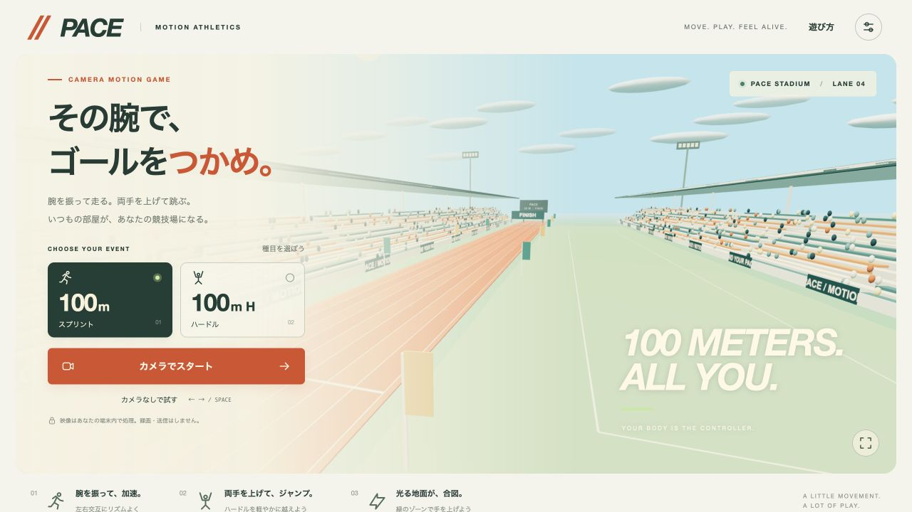

# PACE — カラダで走る、100m。

**腕を振って走る。両手を上げて跳ぶ。ブラウザだけで遊ぶ、カメラモーション陸上ゲーム。**

### [ブラウザで PACE を遊ぶ →](https://k-ishiduka.github.io/pace-motion/)



インストール・アカウント登録・APIキーは不要。公開サイトを開き、カメラを許可すると遊べます。

## 遊び方

1. **100mスプリント** または **100mハードル** を選びます。
2. **カメラでスタート**を押し、カメラを許可します。
3. 肩・ひじ・両手を映して、位置確認ができたらレースを開始します。
4. 左右の腕を走るように交互に振ります。振るたびに加速し、止めると減速します。
5. ハードル手前で**地面が緑に光る区間**に入ったら、**両手を肩より上へ**。次に備えて手を下ろします。

実際に走ったり跳んだりする必要はありません。座ったままでも遊べます。頭上と左右に、手を動かせる空間を確保してください。明るい場所で、手を上げても画面から切れない距離が目安です。

ハードルは **100m・8台のゲーム用コース**です。陸上競技の公式規格を再現するものではありません。

### カメラなしで試す

| 操作                 | キー                                    |
| -------------------- | --------------------------------------- |
| 左右の腕を交互に振る | `←` / `→` または `A` / `D` を交互に押す |
| ジャンプ             | `Space`                                 |
| 一時停止・再開       | `Esc`                                   |

押しっぱなしは加速しません。画面内のボタンでも遊べます。

### 設定と記録

- 腕振り感度は3段階。小さな動きで遊びたい場合は「高い」を選択。
- 効果音、画面の揺れの軽減に対応。
- ベストタイムは種目・入力方式・感度ごとに、このブラウザ内へ保存。
- カメラで体が見えなくなった場合や、別タブに移った場合は一時停止。
- 途中で感度を変更したレースは練習扱いになり、ベストを更新しません。

## プライバシーと動作環境

カメラ映像は端末のブラウザ内で処理します。録画・画像保存・映像のアップロードは行いません。マイクは要求しません。認識モデル・WASM・ゲーム素材はすべてこのサイトから読み込み、外部の推論APIは使いません。初回のカメラ準備では約20MBの読み込みが発生します。閲覧時の通常のアクセスログはホスティング事業者の規約に従います。

HTTPSまたはlocalhost、WebGL、カメラ入力を備えた現行ブラウザが対象です。まずはPCのChrome / Edgeを推奨。スマートフォン向けのレイアウトとタッチ操作もありますが、実機のカメラ性能やブラウザによって認識速度が変わります。

カメラを拒否した場合は、ブラウザのサイト設定からカメラを許可して「再接続」を選択してください。他のアプリでカメラを使用中の場合はそのアプリを閉じます。終了・ホーム移動・カメラ停止・ページ離脱時には映像トラックを停止します。

## 開発

遊ぶ人にNode.jsやPythonは不要です。以下は開発・ビルドする人向けの手順です。

Node.js 22.12以降（24以降推奨）を使用します。

```sh
npm ci
npm run dev
```

表示されたローカルURLを開きます。`index.html`を直接ダブルクリックする方式には対応しません。

```sh
npm test
npm run build
npm run preview
```

`dist/`をHTTPSの静的サイトに置けば公開できます。相対パスでビルドするため、GitHub Pagesのリポジトリ配下にも対応します。

### GitHub Pages

GitHubの **Settings → Pages → Source → GitHub Actions** を選択すると、`main`へのpushごとにテスト・ビルド・公開が実行されます。プルリクエストではテストとビルドだけを実行します。

### 構成

- `src/race.js` — 距離・加速・減速・ジャンプ・衝突・完走
- `src/motion.js` — 肩を基準にした腕振り、両手アップの判定
- `src/camera.js` / `public/pose-worker.js` — 映像入力と端末内姿勢認識
- `src/stadium.js` — Three.jsの3D競技場と速度に応じたジャンプ区間
- `src/main.js` — ゲーム画面、設定、記録、入力の接続

通常はWeb Workerで姿勢認識を行い、非対応環境ではメインスレッドにフォールバックします。認識は最大20fps、描画は独立して更新します。

### 検証

`npm test`で、腕振り・静止・体の平行移動・手の上げ下げ・見失い復帰と、レース開始・減速・中断・衝突・8台連続クリアを検証します。

開発サーバーで `/tests/browser.html` を開いて「検証を実行」を押すと、実カメラを使わず、生成映像で認識モデルの読み込み・解析・停止・キャンセルを検証できます。`/tests/mobile.html` は390px幅の表示確認用です。これらのページは公開ビルドには含まれません。

ブラウザ画面で100mの完走、一時停止・再開、ハードルの成功、結果表示を確認済みです。**人が実際に腕を振る入力の感触、およびスマートフォン実機でのカメラ動作は未検証**です。

## 使用ライブラリと参考資料

- [Three.js](https://threejs.org/) — MIT。3D描画。
- [MediaPipe Pose Landmarker](https://developers.google.com/edge/mediapipe/solutions/vision/pose_landmarker/web_js) — 姿勢推定。`@mediapipe/tasks-vision`はApache-2.0。
- [MediaPipe公式モデル](https://developers.google.com/edge/mediapipe/solutions/vision/pose_landmarker#models) — Pose Landmarker Lite（float16 / version 1）。配布ファイルのSHA-256をビルド時に照合。
- [Vite](https://vite.dev/) — MIT。開発・ビルド。
- [GitHub Pagesのカスタムワークフロー](https://docs.github.com/en/pages/getting-started-with-github-pages/using-custom-workflows-with-github-pages)

競技場、UI、効果音はこのプロジェクトで生成しており、外部の画像・音源・フォントは使用していません。
